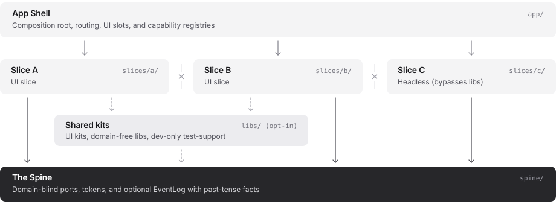
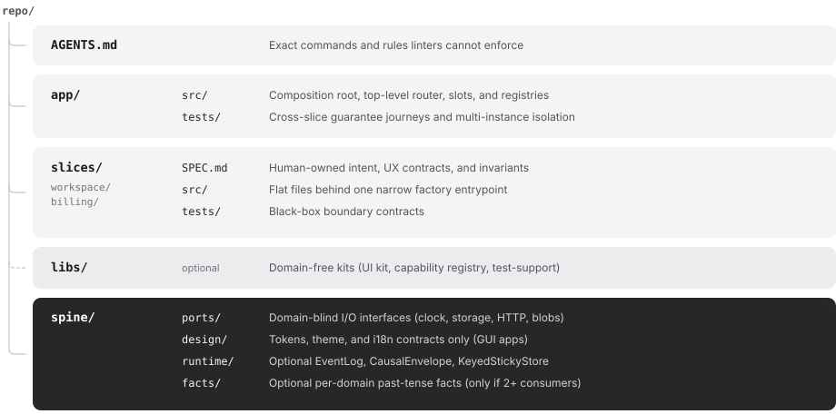

# Clean-Slate Architecture

*A software architecture for agent-built codebases.* ([Research Foundations](RESEARCH.md))

## 1. Flipped Physics

Most software architectures were built around human bottlenecks: org charts, slow typing speeds, and defensive layers meant to keep big teams from stepping on each other.

When coding agents write and maintain most of the code, those constraints flip. An agent can write or rewrite a 1,500-line module in seconds. Where it breaks down is unbounded context, too many similar-looking files (Context Rot), hidden side effects across modules, and layers of indirection that do no real work.

As an agent-built codebase grows, it usually stalls in one of two ways:

- **Spaghetti monoliths (too much coupling):** Changing one feature means reading dozens of files and still risking silent regressions elsewhere. State gets spread across boolean flags, nullable fields, and implicit call ordering, so edge cases fall apart.
- **Enterprise layer cakes (too much indirection):** Splitting a small feature across `Interface`, `UseCase`, `Repository`, `DTO`, `Mapper`, and DI container files fills the model's context with near-miss distractors. Mock-heavy unit tests then freeze those layers in place and break whenever an agent tries to simplify the internals.

Clean-Slate Architecture pairs **strict package boundaries** with **flat, plain internals**.

The core metric is **Working Set Radius**: an engineer or coding agent should be able to build, debug, or completely regenerate any feature by reading only **the Spine and one feature slice**, with the compiler guaranteeing that nothing outside that slice can break. Whether the app has 4 features or 40, the context needed per feature stays flat, and parallel agents in separate git worktrees rarely collide.

**Code isolation is not feature isolation.** Banning imports between slices controls how features connect in code, never whether they work together in the product. Cross-feature workflows stay rich through App Shell composition, typed ports, UI slots, capability registries, and optional Spine facts.

## 2. Topology

Every Clean-Slate codebase has three main tiers enforced by the native build graph (Cargo workspaces, Go modules, SwiftPM, pnpm/Nx workspaces, or Python workspace packages), with zero lateral imports between slices:

<picture>
  <source media="(prefers-color-scheme: dark)" srcset="assets/topology-dark.svg">
  
</picture>

### Standard Layout

<picture>
  <source media="(prefers-color-scheme: dark)" srcset="assets/layout-dark.svg">
  
</picture>

### Tier 1: The Spine (Small, Rigid, Shared)

The Spine is the minimal shared foundation. Keep it small enough to fit comfortably in context on every task.

- **Domain-blind ports, tokens, and optional runtime (`1a`):** Contains shared I/O interfaces (storage namespaces, HTTP transport, clock, typed ID generators, stream/blob handles), optional tokens/theme/i18n contracts (`spine/design`) for GUI apps (never full UI component kits), and an optional `EventLog` runtime. No domain nouns or business rules belong in `ports/`, `design/`, or `runtime/`.
- **Optional fact catalog (`1b`):** Add this only when slices genuinely need reactive fan-out or async disk projections. Facts are immutable, past-tense records made of primitives, small value types, and typed IDs (never mutable objects, untyped JSON blobs, or imperative commands). Split them into per-domain files (`facts/billing_facts`, `facts/workspace_facts`) with zero business logic so parallel branches do not collide on one central file.
- **Opt-in shared kits (`libs/` / `design-kit` / `1c`) and dev-only test support:** Put shared UI component kits, domain-free libraries (markdown, stage, capability registries), and host-facing DTO sub-contracts (`1c`) in opt-in packages between Tier 1 and Tier 2. Forbid headless or non-participating slices from importing them so Working Set Radius stays flat. Put test fakes (`TestEventLog`, fake ports) in a dev-only `test-support` package banned from production builds.
- **No orphan facts, and prefer local duplication over Spine growth:** Only compile a fact into `spine/facts/` when at least two non-test modules participate (a producer and a consumer). Single-slice events stay internal, and planned facts for unbuilt slices live in the producer's `SPEC.md`. Duplicate small helper functions locally across slices rather than pulling generic utilities into the Spine. Local duplication has a one-folder blast radius; Spine bloat taxes every future task.

### Tier 2: Sealed Feature Slices

Each cohesive domain capability is its own package enforced by the build system.

- **Zero cross-feature imports:** Slice A never imports Slice B. It imports only the Spine, opt-in domain-free libs, and external libraries. Pure computational libraries (math, parsing, formatting) can be imported directly. External I/O SDKs (payment gateways, cloud storage, OS hardware APIs) enter through Spine ports or narrow dependency structs at `init` so tests stay offline and fast.
- **One library and one test target:** Never split a slice into separate `Interface`, `Impl`, and `Mocks` packages. Top-down entrypoints and Spine contracts remove the need for per-slice interface targets.
- **Merge before you coordinate:** Slice by whole domain capability, not individual UI widgets, single endpoints, or tiny steps. One cohesive 1,500-line slice is much easier for an agent to work on than four chatty micro-packages. If two peer slices trade back-and-forth coordination events or need lockstep rollbacks (like `Cart` and `Checkout`), they are one domain split in half; merge them. Cross-cutting policy hubs like `Auth` or `Entitlements` stay separate and coordinate through top-down gateways in Tier 3.
- **Owned storage and concept ownership:** Each slice owns its durable state in private storage namespaces, tables, or settings keys. Shared mutable database tables and global preference dumps are forbidden. Keep domain decisions inside the slice that owns the concept, fed by lightweight projections when needed, rather than moving a rule into another slice just because its table sits nearby.

### Tier 3: The App Shell (Thin Composition Root)

The executable target holds zero business logic and adapts to the host runtime.

- **GUI and mobile apps (slot inversion):** Boots the Spine, creates slices, owns top-level navigation and window layout, and passes plain view-slot closures (`() -> View`) when one surface embeds UI from another. For aggregator screens (`Settings`, sidebars, inspectors), invert ownership: domain slices export their own settings rows or panel sections, and the App Shell mounts them as slots. Never build a God-`settings` slice that calls eight domains or put feature rows inside `app/`.
- **Servers, APIs, CLIs, and workers:** Boots the Spine, wires production I/O adapters into slices, maps HTTP/RPC routes, CLI commands, or scheduled triggers to slice entrypoints, and formats top-level responses.
- **Top-down gateways and open capability registries:** When an action needs synchronous policy checks or context assembly across domains (verifying `Auth`, reserving quota in `Billing` before running `Export`, passing `Recall` items into `Conversations`), the App Shell calls the upstream slice first and passes the typed result into the target slice. For extensible host slices (`conversations`, editors), have sibling slices export a uniform domain-blind `Capability` descriptor (tools, prompt notes, presenters) registered in `app/`. Capabilities can then be added or omitted in one line, with no `switch` router or sibling names inside the host slice. Ranking, gating, and prompt or view formatting stay inside slices, never in `app/`.
- **Multi-process apps:** When an app spans multiple local processes (a native OS host, a local server, and a UI view), anchor domain slices in one primary runtime. Treat thin UI views and native hosts as view or hardware bridges over domain-blind IPC ports (`HostChannel(name)`), with a CI check verifying bridge message and event names across processes.

## 3. Data Flow, Runtime Profiles, and Optional EventLog

Most cross-slice collaboration does not need a pub/sub bus. Use the simplest mechanism that fits:

1. **Default: top-down composition, typed ports, slots, and capability registries.** Requests enter through a slice's public entrypoint (`App Shell -> Slice`), aggregator UIs mount slice-owned slots, and extensible hosts consume uniform `Capability` descriptors wired in `app/`. This stays synchronous, traceable, and deadlock-free.
2. **Opt-in: `EventLog` and Integration Facts (for genuine fan-out only).** Add an `EventLog` only when multiple independent slices genuinely react to the same past-tense state change. Never add one as ceremony or as a disguised command bus.

### A. Two Runtime Profiles

Slices always own durable storage on disk, and the Spine never becomes a shared database or global event store.

1. **Profile 1: Multi-surface stateful apps (desktop, mobile, web, local-first clients).** When several live UI surfaces react to shared state, an optional ephemeral `EventLog` backed by an in-memory **Keyed Sticky Store** compacted by `(FactType, Key)` gives late subscribers deterministic startup projections without cross-slice imports. Use a `unit` key for singletons (`SessionState`), entity IDs for collections (`WorkspaceSummary`), and tombstones for eviction.
2. **Profile 2: Embedded engines, harnesses, servers, multi-tenant APIs, and CLIs.** Multi-tenant servers never preload tables into RAM, short-lived CLIs never pay boot-hydration costs, and headless embedded libraries or harnesses skip `EventLog` theater completely. Requests run through top-down synchronous calls (`App Shell -> Slice`), synchronous lifecycle ports (`ToolPack.handle`), and a single canonical output stream for hosts. When a server needs cross-domain read views, Integration Facts publish discretely (in-process or via a transactional outbox/broker) to update private, read-only projection tables on disk.

### B. Private Actions vs. Public Integration Facts

- **Private actions** stay inside a slice (`buttonTapped`, `retryFired`, `chunkParsed`) to drive local state transitions.
- **Public Integration Facts (`Slice -> Spine -> Subscribers`)** are published only when a domain truth occurs that another slice actually reacts to (`WorkspaceOpened`, `SubscriptionRenewed`). Facts are always immutable, past-tense truths shaped in the producer's domain. Never publish imperative commands (`PleaseUploadFile`, `*Requested`), never build disguised **RPC-over-the-Log** (`OrderCreationRequested` waiting on `OrderCreationCompleted`), and never emit consumer-shaped sinks (`SearchDocumentPrepared`). Downstream slices own their own translation adapters.

### C. Causal Envelopes and Loop Breaking

When an `EventLog` is used, `spine/runtime` wraps every published fact in a causal envelope: `(id, timestamp, causationID, hopDepth)`.

- If a slice emits a new fact while handling an incoming fact, `causationID` points to the trigger and `hopDepth` increments.
- The Spine asserts `hopDepth < maxHops` (for example, `12`), turning accidental cross-slice loops into immediate failures with a full causal trace.

### D. Control Plane Only

The `EventLog` is a control plane, not a byte pipe. High-frequency streams (audio/video frames, pointer tracking, live token streams) and large binary payloads stay in Spine/OS stream buffers or blob storage. Facts carry only lightweight typed handles (`RecordingSaved(blobID)`).

## 4. Inside a Slice

Structural variation across slices wastes attention. Every slice follows the same simple internal layout:

1. **Human-owned `SPEC.md` and narrow factory entrypoint:** Each slice has a short `SPEC.md` (1-2 pages covering behavior, UX obligations, and domain invariants, with tunable parameters like thresholds, timeouts, and window sizes separated into a parameters table so tests do not freeze untuned numbers). Define ambiguous terms explicitly and prune superseded clauses whenever requirements change, since agents silently guess on vague prose and keep following stale intent. Each slice exposes one narrow factory entrypoint (`create*Slice` or `init` returning `dispose()`). Everything else in `src/` stays `internal` or `private`. Never export internals for tests or hollow out a slice into a bag of host callbacks.
2. **Multi-instance isolation and zero back-channels:** Slices must support multiple independent instances in one process. Avoid module-level singletons, static service locators, ambient OS globals (`UserDefaults`, `FileManager.default`, `indexedDB.open`, `NSApp.windows`), custom `NotificationCenter` domain buses, and polling bridges. All external state enters through injected Spine ports.
3. **Explicit state, pure kernels, and loud failures:** Model stateful lifecycles and certainty (such as confirmed vs. inferred values) with sum types / tagged unions (`Idle | Loading | Ready | Failed`) instead of boolean flag soup or string punctuation. Static types pay off through fast compiler feedback and CI-enforced bans on escape hatches (`any`, unchecked casts, skipped hooks), not passively on their own. Keep stateless operations as plain functions. For complex stateful slices, split a pure synchronous kernel (the sole writer of its state, with no discarded transition results or shadow state) from a thin effect runner that handles concurrency, timers, teardown, and I/O. Never hide invariant failures in bare `catch {}` blocks or silent fallback defaults.
4. **Flat directory layout:** Keep files flat inside `src/` until scale genuinely calls for subfolders. Skip pass-through `UseCase`, `Repository`, and `Mapper` wrappers that add no domain logic.

## 5. Verification, Operating Modes, and Regeneration

Traditional unit testing catches human translation slips, where a developer has the right mental model and makes a coding mistake. Coding agents fail across two different horizons:

- **At `t = 0` (concept verification):** An agent can state a rule accurately and still violate it in code (*Potemkin Understanding*), then write example tests on canonical "keystone" inputs where its surface fluency holds up.
- **At `t = 50` (regression memory):** Fifty commits later, a fresh stateless agent session arrives with zero memory of why a slice handled past edge cases.

Clean-Slate solves both horizons with a single sealed-boundary test suite that runs in milliseconds (see [Research Foundations](RESEARCH.md) for the empirical studies behind these rules).

### 1. At `t = 0`: Spec-Derived Oracles and Randomized Invariants

- **Write contracts from `SPEC.md`, not by reading `src/`:** Author boundary contracts from the slice's `SPEC.md`, `spine/`, and public entrypoint signature while `src/` is unwritten or hidden. This keeps tests independent of implementation bugs while remaining compilable.
- **Test invariants across randomized inputs:** Example unit tests (`assert calculateTax(100) == 10`) let an agent mirror its own blind spots on happy-path inputs. Favor randomized algebraic properties and state invariants: round-trip symmetry (`decode(encode(x)) == x`), conservation (`sum(lineItems) == invoiceTotal`), idempotency under duplicate delivery, and unrepresentable state transitions. Randomized probes expose both conceptual bugs and hardcoded test shortcuts.

### 2. At `t = 50`: Subcutaneous Slice Contracts as Regression Memory

Because "merge before you coordinate" packs a whole capability (up to ~1,500 lines) into one slice, testing only cross-slice Spine events leaves internal business rules (leap-year proration, refund idempotency, partial-payment edge cases) exposed across future commits and regenerations. Meanwhile, mocked internal unit tests freeze call graphs and break refactors.

Subcutaneous Slice Contract Tests (black-box tests at the slice boundary) live in `slices/<name>/tests/` (never inline in production files) and act as the slice's durable regression memory. They run the real slice against an in-memory `TestEventLog`, `:memory:` storage, and fake I/O ports:

- **Given** initial storage state and any prior facts seeded on `TestEventLog` -> **When** a public entrypoint or incoming Spine fact fires -> **Then** assert only on observable outputs, persisted state via public reads, and outgoing Spine facts.

With no real databases, containers, networks, or mock frameworks in the loop, a slice suite finishes in milliseconds. Complex pure algorithms inside a slice (parsers, pricing engines, CRDT merges) may carry mock-free property tests treated explicitly as disposable internal scaffolding that future refactors can freely replace.

Verify cross-slice health with **two executable proof suites in `app/tests/`** instead of heavy custom regex linters:

- **Cross-Slice Guarantee Journeys:** Boot real slices together against fake ports to verify that every cross-slice product guarantee (for example, quitting stops background jobs) stays wired across refactors.
- **Multi-Instance Isolation Proof:** Create two independent app or slice instances in the same process, mutate Instance A, and assert Instance B is untouched. One runtime test catches module-level singletons, ambient OS globals, and hidden coupling together.

### 3. Operating Modes and Workflow Discipline

- **Feature Mode (everyday work):** When adding features or changing cross-slice behavior, an agent edits `SPEC.md`, `spine/facts/`, `tests/`, and `src/` in one fluid pass without permission deadlocks. CI and git review flag any diff touching `spine/` or `tests/` for human sign-off.
- **Locked-Contract Mode (refactors, bug fixes, regeneration):** When refactoring or fixing internals against settled behavior, mount `spine/`, `SPEC.md`, and `tests/` read-only. Pair locked runs with a **Stop-and-Escalate** rule: if `SPEC.md`, `spine/`, and `tests/` conflict, stop and surface the conflict. Never weaken assertions, stub checks, or swallow errors.
- **What static checks cannot catch:** Spec-first oracle independence, meaningful `SPEC.md` invariants, and non-tautological property tests cannot be statically linted. Enforce them in your workflow: write `SPEC.md` and `tests/` against a stub entrypoint before `src/` exists, review `SPEC.md` as a human, confirm new tests fail on a stub or planted bug before going green, and audit property-test generator ranges and `assume()` guards (or run periodic mutation checks) rather than trusting fail-first alone.
- **The Refactors-Are-Free Litmus Test:** If you rewrite `src/` without changing external behavior and a test breaks, that test is coupled to internals. Delete it or rewrite it at the boundary.

### 4. Targeted Clean-Slate Regeneration

Empirical studies show that passing agent-authored code imposes no measurable maintenance penalty on later sessions, while continuing from broken or half-finished attempts triggers heavy acceptance bias (successor agents keep almost all broken lines instead of rethinking the design). Leave working slices alone rather than rewriting them for style. When a slice attempt gets tangled or fails repeatedly, wipe `slices/<name>/src/*` and regenerate it from read-only `SPEC.md`, `spine/`, and `slices/<name>/tests/*`.

## 6. Decision Heuristics

| Always Prefer | Strictly Avoid |
| :--- | :--- |
| **1 cohesive domain = 1 sealed slice** | Cross-slice imports, widget-sized micro-packages, or Interface/Impl target splits |
| **Top-down composition, slots, and capabilities (opt-in EventLog)** | `EventLog` theater in headless engines, imperative `*Requested` facts, or consumer-shaped sinks |
| **Merging chatty peer slices (+ top-down gateways)** | RPC-over-the-Log, business logic in App Shell, or God-slices (`settings` calling 8 domains) |
| **Tiny Spine + opt-in shared kits (`libs/` / `test-support`)** | Dumping UI component kits into `spine/design` or shipping test fakes in production targets |
| **Concept ownership + local helper duplication** | Moving rules for storage convenience, bloating the Spine, or compiling orphan facts |
| **`SPEC.md` (invariants vs. parameters) + sum-type state** | Freezing untuned numbers in tests, boolean flag soup, string-punctuation provenance, or bare `catch {}` |
| **Build-graph walls + executable proof tests** | 500-line custom regex linters, post-hoc mirror tests, internal mocks, or patching failed residual attempts |

### The Blast-Radius Tie-Breaker and Three Outcome Tests

When a trade-off feels ambiguous, use one rule: **strict at the seams, pragmatic inside the slice.** A messy file inside a sealed 1,500-line slice has a one-folder blast radius and can be regenerated from `SPEC.md` and `tests/` in minutes. A shortcut in the Spine or build graph taxes every future task.

Judge a repo's Clean-Slate health by **three outcome tests**, not a compliance checklist:

1. Can an agent change a feature by reading only the Spine and one slice?
2. Do slice tests run offline in under a second and catch real invariant bugs?
3. Can you delete `slices/<x>/src/*` and regenerate it cleanly from `SPEC.md` and `tests/`?

If all three hold, stop auditing and ship.

## Appendix: Minimal Mechanical Gates and the `AGENTS.md` Kernel

Research shows that long prose overviews, restated linter rules ("Lint Leakage"), and mode-specific workflows ("Skill Leakage") in `AGENTS.md` inflate token usage and exploration steps, while short operational maps with exact commands cut runtime and output tokens. Attach a brief rationale to any repo-specific rule you add to `AGENTS.md` so obsolete rules get pruned instead of accumulating over time. Rely on the native build graph and two executable proof tests instead of maintaining a 500-line custom regex linter per repo, and place only the compact contract below in your repository root.

### Minimal Mechanical Gates (Build Graph + CI)

- **Native build-graph walls:** Enforce zero lateral slice imports, opt-in `libs/` and `1c` scoping, dev-only `test-support`, zero `@_exported import`, and boundary-only test imports (package entrypoint only; no `../src` or `@testable import`).
- **Executable proof tests (`app/tests/`):** Run **Multi-Instance Isolation** (catches singletons and ambient OS globals at runtime) and **Cross-Slice Guarantee Journeys** (catches dropped wires).
- **Targeted CI checks:** Flag diffs touching `spine/` or `tests/` for human sign-off, ban type escape hatches (`any`, unchecked casts, skipped strict hooks) in strict stacks, check cross-process bridge names in multi-process apps, and, only where an `EventLog` is used, verify zero orphan facts (`>= 2` non-test modules). Treat symbol counts, gateway counts, and style rules as lightweight review heuristics.

### `AGENTS.md` Machine Kernel

```markdown
# Architecture: Clean-Slate Architecture

## Commands (Replace per stack)
- Test one slice (sub-second): <run-slice-tests> slices/<target>
- Test shell wiring & isolation proofs: <run-app-tests> app
- Verify build & DAG boundaries: <check-dag>

## Authoring Rules
- Code isolation != feature isolation: Zero cross-slice imports controls how features connect in code, never whether they work together in the product. Prefer top-down composition, typed ports, UI slot inversion, and open Capability registries in app/. Use an EventLog only for genuine multi-surface fan-out, never polling loops, NotificationCenter domain buses, or static service locators.
- Working set: Scope slice tasks to spine/ + slices/<target>/ (SPEC.md, src/, tests/). Touch app/ only for factory composition, routing, UI slot mounting, or top-down gateway/context handoffs. Keep domain rows, gating, ranking, and prompt or view formatting inside slices, never in app/.
- Spine and opt-in libs: Keep spine/ports, spine/design (tokens, theme, and i18n only), and optional spine/runtime 100% domain-blind. Put shared UI kits, domain-free libraries, and host-only DTOs in opt-in scoped packages forbidden to non-participating slices, and test fakes in dev-only test-support. If using spine/facts/, name facts in the producer's past-tense domain and compile only with >= 2 non-test modules. Duplicate small local helpers over growing spine/.
- Ownership and runtime: Keep decisions in the owning slice. Use Profile 1 (optional KeyedStickyStore) for multi-surface reactive UI apps, and Profile 2 (synchronous ports + canonical host stream, or discrete facts + disk projections) for embedded engines, harnesses, servers, and CLIs. Every slice is factory-scoped with dispose(), zero module-level singletons, and zero ambient OS globals.
- State, specs, and errors: Separate behavioral invariants from tunable parameters in SPEC.md and prune superseded clauses. Model stateful lifecycles and certainty with explicit sum types (zero boolean flag soup, string punctuation, or type escape hatches). Keep stateless handlers as plain functions and complex stateful slices as a pure synchronous kernel + thin effect runner. Never mask failures with bare catch {} blocks.
- Verification and escalation: Test only sealed boundaries in slices/<target>/tests/ (public package entrypoint + test-support fakes; zero internal mocks, zero ../src or @testable imports) and cross-slice guarantees + multi-instance isolation in app/tests/. Write assertions and randomized invariants from SPEC.md + spine/ + entrypoint types before src/ exists (fail-first on a stub or bug). If SPEC.md conflicts with spine/ or tests/, STOP and escalate; never weaken assertions.
```
